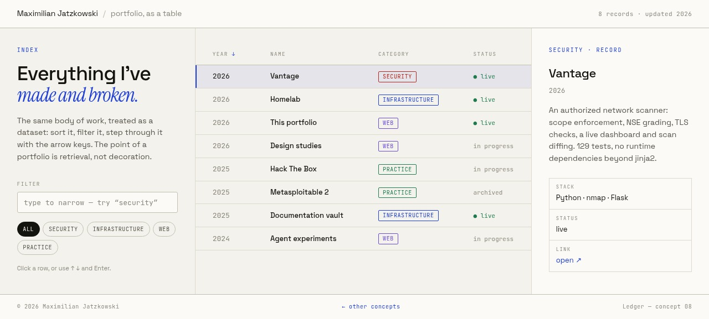

<div align="center">
  
</div>

<h1 align="center">Ledger</h1>

<p align="center"><em>A portfolio as a queryable record.</em></p>

<p align="center">
  <a href="https://noxwer-beep.github.io/ledger/">Live</a> ·
  <a href="https://noxwer-beep.github.io/showcase/">All eight concepts</a> ·
  <a href="https://noxwer-beep.github.io/portfolio/">Portfolio</a>
</p>

---

Instead of scrolling a list of projects, you filter it. Every entry is a row with tags
and a date, the detail pane is part of the page, and the keyboard works. It is the one
concept here that behaves like a tool.

## What is in here

```
index.html   the shell: filter, chips, grid, detail pane
style.css    the record: ruled rows, tabular numbers, dense type
main.js      filter + sort + keyboard navigation + detail rendering
css/         self-hosted fonts (Space Grotesk, IBM Plex Mono)
```

Three files, no framework, no build step. The data lives in `main.js` as an array.

## Run it

```bash
python3 -m http.server 8000
# http://localhost:8000
```

## What it demonstrates

- **A filter that says when nothing matches**, instead of leaving a blank area.
- **Keyboard navigation** — arrows or `j`/`k` move the selection and update the
  detail pane, `enter` opens the record's link, `escape` clears the query. The focus
  ring is never removed without a replacement.
- **A detail pane that does not reflow the page.** Open an entry and the layout holds
  still.
- **Tabular figures**, so the columns line up.

## Related

- [showcase](https://github.com/Noxwer-beep/showcase) — the gallery and design notes
- [portfolio](https://github.com/Noxwer-beep/portfolio) — the real site

MIT.
